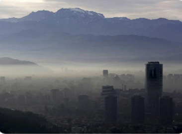
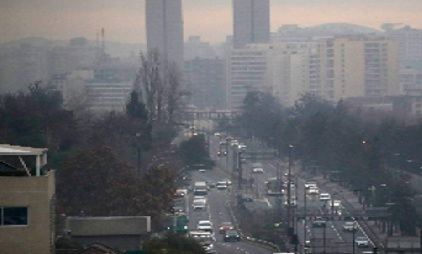
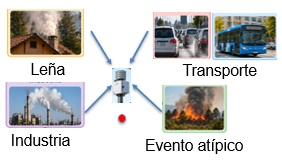
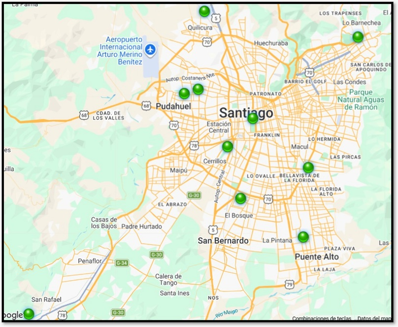
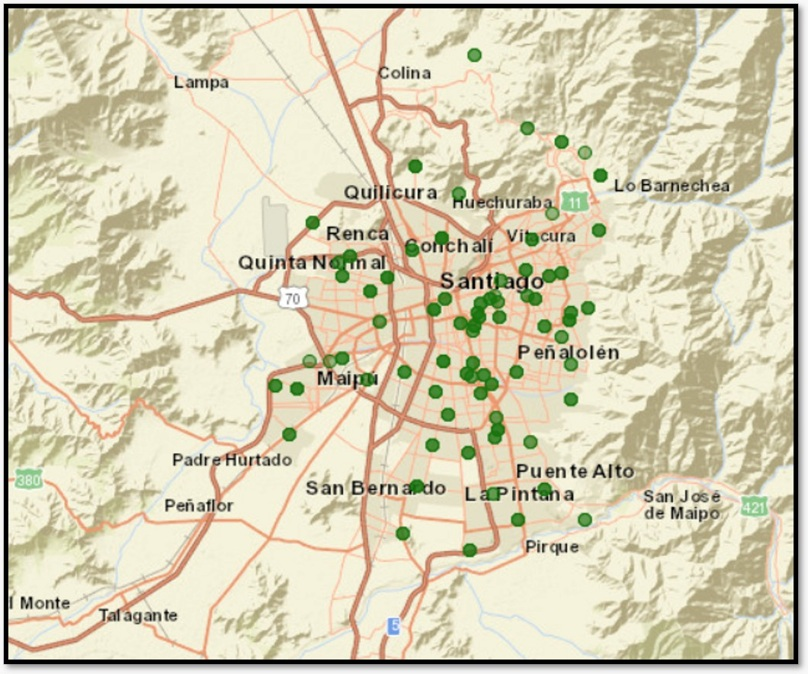
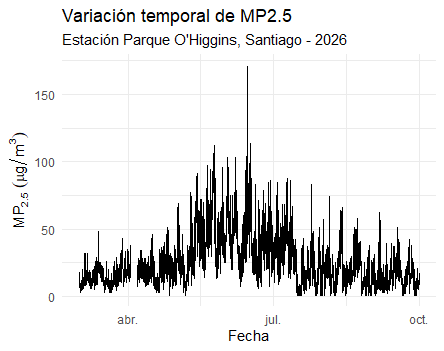
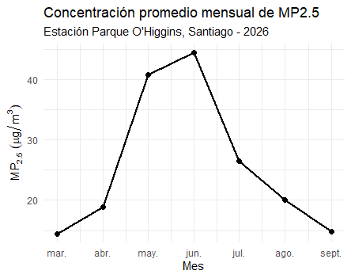

---
---
title: "Análisis exploratorio del MP2.5 en Santiago de Chile"
author: "María Cristina Olivera Ferrer"
date: "22 de octubre de 2026"
output: html_document
---
---

# ¿Cómo varían las concentraciones de MP2.5 en diferentes sectores de Santiago de Chile?

## 1. Contexto y relevancia de la contaminación por MP2.5 en Santiago de Chile

La contaminación atmosférica constituye uno de los principales problemas ambientales que afectan la salud de las poblaciones urbanas. Entre los contaminantes de mayor preocupación se encuentra el material particulado fino (MP2.5), definido como el conjunto de partículas sólidas y líquidas suspendidas en el aire cuyo diámetro aerodinámico es igual o inferior a 2,5 micrómetros (µm). Esta dimensión equivale aproximadamente a una treintava parte del grosor de un cabello humano, lo que permite comprender su tamaño extremadamente reducido (Organización Mundial de la Salud [OMS], 2024).

El MP2.5 no corresponde a una única sustancia química, sino a una mezcla compleja cuya composición depende de las fuentes de emisión y de los procesos atmosféricos. Puede contener sulfatos, nitratos, amonio, carbono negro, compuestos orgánicos, polvo mineral, entre otros componentes. Estas partículas pueden emitirse directamente mediante procesos de combustión, como los asociados al transporte vehicular, las actividades industriales y la calefacción residencial, o formarse secundariamente en la atmósfera a partir de reacciones químicas entre contaminantes gaseosos.
Debido a su pequeño tamaño, las partículas finas pueden penetrar profundamente en el sistema respiratorio, alcanzar los alvéolos pulmonares y, en algunos casos, contribuir a la exposición sistémica a sus componentes. La exposición al MP2.5 se relaciona con efectos adversos sobre la salud respiratoria y cardiovascular, incluyendo el agravamiento de enfermedades preexistentes y un mayor riesgo de mortalidad prematura. La OMS reconoce la contaminación atmosférica como un factor importante de riesgo para la salud pública y recomienda reducir las concentraciones de material particulado fino (OMS, 2021).

En Chile, la contaminación por MP2.5 constituye un desafío ambiental relevante, especialmente en ciudades donde las emisiones procedentes de la combustión se combinan con condiciones meteorológicas que dificultan su dispersión. El Ministerio del Medio Ambiente reconoce diversas fuentes de emisión de este contaminante, entre ellas el transporte vehicular, las actividades industriales, la combustión residencial de leña y los incendios forestales (Ministerio del Medio Ambiente, 2026).

En Santiago de Chile, la situación adquiere particular importancia debido a su configuración geográfica. La ciudad se encuentra emplazada en una cuenca delimitada por la cordillera de los Andes y la cordillera de la Costa. Durante los meses de otoño e invierno, la ocurrencia de condiciones de estabilidad atmosférica, vientos débiles y una menor altura de la capa de mezcla favorece la acumulación de contaminantes cerca de la superficie. Muñoz et al. (2023) estudiaron las condiciones meteorológicas asociadas con episodios de contaminación por material particulado en Santiago y destacaron la influencia de estos procesos sobre la calidad del aire.

&nbsp;

&nbsp;

Además de los factores meteorológicos, las concentraciones de MP2.5 dependen de las emisiones presentes en el entorno urbano. Jorquera y Barraza (2012) estudiaron la contribución de diferentes fuentes a las concentraciones ambientales de MP2.5 en Santiago, evidenciando la importancia de comprender la diversidad de procesos que influyen en este contaminante.

&nbsp;

Sin embargo, las concentraciones de MP2.5 no necesariamente presentan un comportamiento uniforme en toda la ciudad. Su variabilidad espacial y temporal puede estar relacionada con la distribución de las fuentes de emisión, las características del entorno urbano y las condiciones meteorológicas. Por ello, resulta relevante estudiar cómo cambian las concentraciones entre distintas localidades y a lo largo del tiempo.

En Chile, el Sistema de Información Nacional de Calidad del Aire (SINCA), administrado por el Ministerio del Medio Ambiente, permite consultar registros de calidad del aire provenientes de estaciones oficiales de monitoreo. Esta red constituye una fuente fundamental de información para la vigilancia ambiental, el seguimiento histórico de los contaminantes y la gestión de la calidad del aire (Ministerio del Medio Ambiente, s. f.).

&nbsp;

No obstante, la distribución de las estaciones oficiales limita la resolución espacial con la que pueden describirse las diferencias de concentración dentro de una ciudad. En este contexto, las redes de sensores de bajo costo previamente calibrados constituyen una alternativa complementaria, al permitir incorporar mediciones en un mayor número de ubicaciones y explorar la variabilidad espacial del MP2.5 con mayor detalle.

En Santiago se dispone de una red de sensores de bajo costo cuyos registros pueden consultarse mediante la plataforma Aire Ciudadano, en su panel de sensores CHS. La combinación de estos registros con las mediciones oficiales de SINCA ofrece una oportunidad para explorar patrones temporales y diferencias locales en las concentraciones de MP2.5.

&nbsp;

La comparación de los mapas permite observar diferencias en la densidad espacial de los puntos de monitoreo. Mientras que las estaciones oficiales SINCA se distribuyen en ubicaciones específicas de Santiago, la red de sensores de bajo costo presenta una mayor cantidad de puntos de medición en diferentes sectores de la ciudad. Esta característica permite complementar la información oficial y ofrece oportunidades para explorar con mayor detalle la variabilidad espacial de las concentraciones de MP2.5. No obstante, la interpretación de estas diferencias requiere considerar la calibración, la ubicación y la disponibilidad temporal de los sensores.

En este contexto, surge la pregunta que orienta el presente análisis: ¿cómo varían las concentraciones de MP2.5 entre distintos sectores de Santiago de Chile y qué semejanzas o diferencias se observan entre los registros de las estaciones SINCA y los sensores de bajo costo calibrados ubicados en sus proximidades?

## 2. Datos y área de estudio

El estudio se desarrollará en tres sectores de Santiago de Chile: Puente Alto, Cerro Navia y Parque O'Higgins, seleccionados por la disponibilidad de registros de material particulado fino (MP2.5) provenientes de estaciones oficiales de monitoreo y sensores de bajo costo calibrados ubicados en sus proximidades.

Se utilizarán datos de concentración horaria de MP2.5 correspondientes al año 2026, obtenidos de dos fuentes de información:

- **Red oficial SINCA:** registros horarios de las estaciones Puente Alto, Cerro Navia y Parque O'Higgins, correspondientes al período comprendido entre el 1 de marzo y el 30 de septiembre de 2026.

- **Sensores de bajo costo calibrados:** registros de cuatro sensores, identificados como CH2 y CH3 (Puente Alto), CH4 (Cerro Navia) y CH56 (Parque O'Higgins), cuyos períodos de medición deberán verificarse a partir de los archivos disponibles.

Debido a las diferencias en la disponibilidad temporal de las mediciones, las comparaciones entre las estaciones SINCA y los sensores de bajo costo se realizarán considerando únicamente los registros correspondientes a fechas y horas coincidentes.

Esta selección permitirá explorar la variabilidad temporal y las diferencias entre los sectores estudiados, así como examinar las semejanzas y diferencias entre las concentraciones registradas por ambas redes de monitoreo.

## 3. Estrategia de análisis exploratorio y visualización de datos

El análisis exploratorio se desarrollará en R y estará orientado a caracterizar la variabilidad espacial y temporal de las concentraciones de MP2.5 registradas en los sectores seleccionados de Santiago de Chile.

En primer lugar, se revisará la estructura y calidad de los registros disponibles, identificando valores faltantes, períodos de medición y posibles observaciones atípicas. Posteriormente, se examinará la evolución temporal de las concentraciones de MP2.5 y se comparará su distribución entre las localidades estudiadas.

Finalmente, se explorarán las semejanzas y diferencias entre las mediciones de las estaciones SINCA y los sensores de bajo costo calibrados cercanos, utilizando únicamente los períodos con registros simultáneos.

Para comunicar los resultados se prevé utilizar series temporales, diagramas de caja y gráficos de dispersión, seleccionados según las características de los datos y las preguntas del análisis. Las visualizaciones buscarán presentar la información de manera clara y comprensible, siguiendo los principios de narrativa y comunicación científica de Wilke (2019).

### 3.1.Preguntas exploratorias

Para orientar el análisis de las concentraciones de MP2.5 en Santiago de Chile, se plantean las siguientes preguntas:

1. ¿Cómo varían temporalmente las concentraciones de MP2.5 en Puente Alto, Cerro Navia y Parque O'Higgins durante los períodos de estudio?

2. ¿Qué diferencias se observan en la distribución de las concentraciones de MP2.5 entre los tres sectores seleccionados?

3. ¿Qué semejanzas y diferencias presentan los registros horarios de las estaciones SINCA y los sensores de bajo costo calibrados ubicados en sus proximidades, considerando únicamente los períodos de medición coincidentes?

### 3.2.Visualizaciones exploratorias preliminares

Como primera aproximación al análisis de los datos, se exploraron las concentraciones horarias de MP2.5 registradas en la estación SINCA Parque O'Higgins durante el período disponible de 2026.

Estas visualizaciones representan una exploración inicial de una de las estaciones seleccionadas. En las siguientes etapas del proyecto se incorporarán los registros de Puente Alto y Cerro Navia, así como los sensores de bajo costo calibrados, para examinar las diferencias temporales y espaciales entre los sectores estudiados.

&nbsp;

&nbsp;

Como resultado de esta primera exploración, se observa una marcada variabilidad temporal de las concentraciones de MP2.5 en la estación Parque O'Higgins. La serie horaria muestra episodios de concentraciones elevadas durante los meses de otoño e invierno, mientras que los promedios mensuales presentan un aumento hacia junio, mes en el que se registra el valor promedio más alto del período analizado. Estos resultados preliminares sugieren la existencia de diferencias estacionales en las concentraciones de MP2.5

## 4. Resultados esperados y alcance del análisis

Se espera que el análisis exploratorio permita identificar los principales patrones de variación temporal de las concentraciones de MP2.5 en Puente Alto, Cerro Navia y Parque O'Higgins durante los períodos estudiados, así como describir las diferencias observadas entre estas localidades.

Asimismo, mediante la comparación de registros horarios coincidentes, se buscará examinar las semejanzas y diferencias entre las concentraciones medidas por las estaciones SINCA y los sensores de bajo costo calibrados ubicados en sus proximidades.

Los resultados se comunicarán mediante visualizaciones elaboradas en R, procurando que cada gráfico responda a un propósito específico y contribuya a construir una narrativa clara sobre el comportamiento del MP2.5 en Santiago de Chile.

El alcance del proyecto será descriptivo y exploratorio. Por tanto, no se pretende determinar las fuentes responsables de las concentraciones observadas ni realizar una validación instrumental definitiva de los sensores. Las conclusiones estarán condicionadas por la disponibilidad temporal de los registros y las diferencias de ubicación entre los puntos de medición.

## 5. Referencias bibliográficas
Aire Ciudadano. (s. f.). *Sensores CHS: Plataforma de monitoreo de calidad del aire*. https://sensor.aireciudadano.com/d/xTdfdbchs/sensores-chs?orgId=1

Jorquera, H., & Barraza, F. (2012). Source apportionment of ambient PM2.5 in Santiago, Chile: 1999 and 2004 results. *Science of the Total Environment, 435–436*, 418–429. https://doi.org/10.1016/j.scitotenv.2012.07.049

Ministerio del Medio Ambiente. (2026). *Informe consolidado de emisiones y transferencias de contaminantes del RETC: Datos 2023*. https://retc.mma.gob.cl/wp-content/uploads/2026/01/INFORME-RETC-2023.pdf

Ministerio del Medio Ambiente. (s. f.). *Sistema de Información Nacional de Calidad del Aire (SINCA)*. https://sinca.mma.gob.cl/

Muñoz, R. C., Garreaud, R., Rutllant, J. A., Seguel, R., & Corral, M. (2023). New observations of the meteorological conditions associated with particulate matter air pollution episodes in Santiago, Chile. *Atmosphere, 14*(9), 1454. https://doi.org/10.3390/atmos14091454

Organización Mundial de la Salud. (2021). *WHO global air quality guidelines: Particulate matter (PM2.5 and PM10), ozone, nitrogen dioxide, sulfur dioxide and carbon monoxide*. https://www.who.int/publications/i/item/9789240034228

Organización Mundial de la Salud. (2024, 25 de junio). *Health consequences of air pollution*. https://www.who.int/news/detail-global/25-06-2024-what-are-health-consequences-of-air-pollution-on-populations

Wilke, C. O. (2019). *Fundamentals of Data Visualization*. O'Reilly Media. https://clauswilke.com/dataviz/
